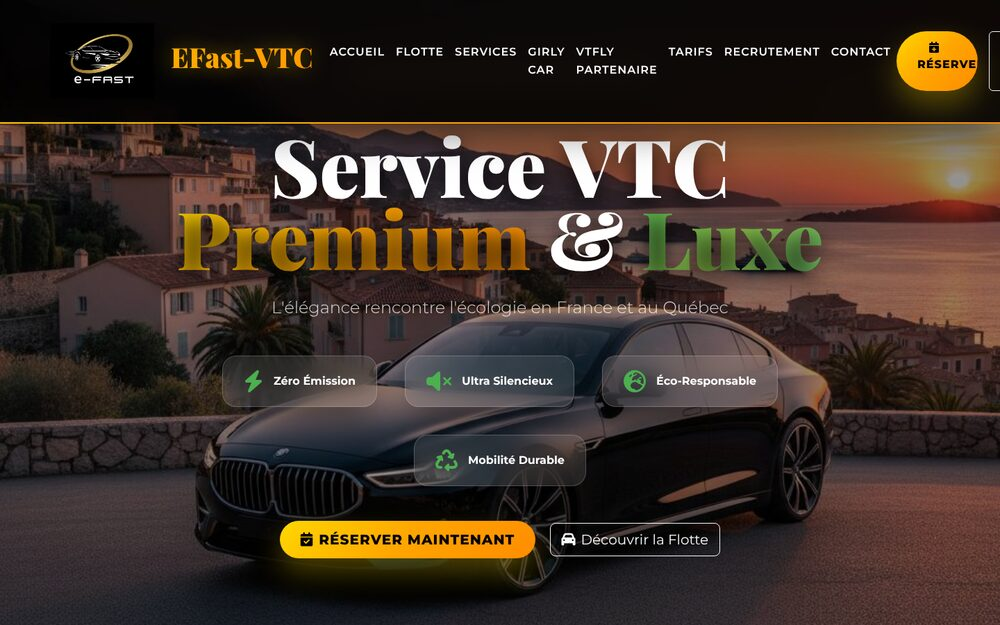

  

> Première version du site de réservation VTC eFast, avec formulaire en PHP.

  

  

**Statut** — 🟢 Site en ligne sur [efast-vtc.com](https://www.efast-vtc.com) — ce dépôt est la V1

---

# eFast V1

## Le problème

Un chauffeur VTC reçoit ses demandes par téléphone et par message, sans trace écrite ni créneau confirmé. Il faut un point d'entrée qui cadre la demande.

## Ce que fait le projet

- Présentation de la flotte, véhicule par véhicule : Tesla, Mercedes, BMW, MG4, MG5, Bentley
- Bannières par destination : Cannes, Monaco
- Un formulaire de réservation envoyé par `send_reservation.php`
- Plusieurs variantes de page d'accueil, gardées pour comparer les mises en page

## Structure

`index.html`, `index2.html`, `index3.html`, `page3.html` les variantes · `send_reservation.php` le formulaire · `images/` la flotte et les bannières

## Lancer le projet

Déposer le dossier sur un hébergement PHP. Le formulaire a besoin d'un PHP avec l'envoi de mail configuré.

---

Développé par **Bakari Abidina** · [bakabi.fr](https://bakabi.fr)
